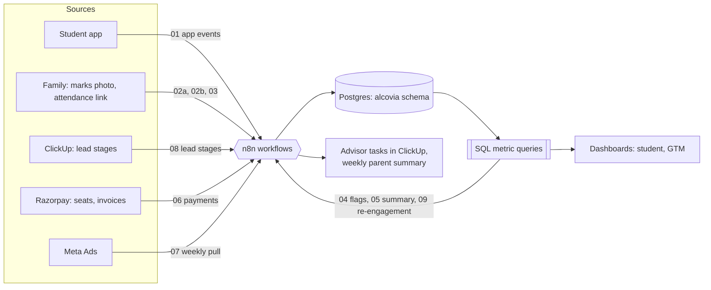

# How the pieces fit

One central Postgres store. n8n writes to it. The dashboards and the advisor tasks read from it.

## The rule behind every table

Nothing is typed twice, and nothing is typed by someone who was not there.

| What a person still has to do | Everything else is |
|---|---|
| Tap a rating after a session | App activity: automatic |
| Upload a photo of marks | Attendance: a link, or a meeting export |
| Verify marks in the weekly review | Syllabus readiness: from quiz scores |
| Judge roadmap status and workshop soft skills | Lead stages: from ClickUp status changes |

## Decisions that show up in the schema

- **Verified focus is a generated column** on `app_sessions`, so it cannot be set by hand: app in the foreground, idle time of 300 seconds or less, and a one-tap check-in.
- **Marks are unverified until an advisor checks them** (`exam_results.verified_at`). Family queries read only verified rows.
- **A cancelled session is never counted against a student** (`program_events.held`).
- **One name per subject** (`subjects.name` is unique), which removes the "Math" and "Mathematics" duplicate.
- **Campaign thresholds live in a table** (`gtm_rules`), so they are set from real results and not hard-coded.
- **Every lead carries a source** (`leads.source`), because cost per qualified lead is a guess without it.
- **A minor's data needs written consent** (`guardians.consent_at`) before any family message goes out.
